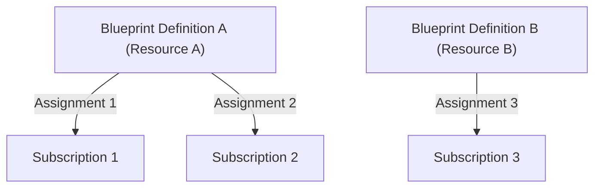

# Azure Blueprints

> [!NOTE]
> **AZ-305 Exam Note:** Azure Blueprints is in maintenance/retirement (succeeded by **Deployment Stacks** and **Template Specs**), but blueprint governance concepts (locks, artifacts, and scoping) are still tested.

## Purpose
1. **Container for Artifacts:** A blueprint packages 4 types of artifacts:
    - **Resource Groups**
    - **ARM / Bicep Templates** (deploy resources)
    - **Azure Policy Assignments** (governance & compliance)
    - **RBAC Role Assignments** (access control)
2. **Storage & Versioning:**
    - Blueprint definitions can be saved at the **Management Group** or **Subscription** level. Storing at a Management Group allows inheritance across all child subscriptions.
    - Native support for versioning (Draft vs. Published versions like `1.0`, `1.1`).
3. **Publishing:** Definitions must be **published** before they can be assigned.
4. **Lifecycle & Resource Locking:**
    - Unassigning/deleting a blueprint assignment does **not** delete deployed resources.
    - Uses Azure RBAC **Deny Assignments** (`Do Not Delete` or `Read Only`), preventing even Subscription Owners from modifying or deleting protected resources.
    - To remove a lock: change the assignment setting to **Don't Lock** or **unassign (delete) the blueprint assignment** (which lifts the Deny Assignment).
5. **RBAC Roles:**
    - **Blueprint Contributor:** Can create/edit blueprint definitions, but cannot assign them.
    - **Blueprint Operator:** Can assign existing published blueprints, but cannot edit definitions.
    - **Owner:** Full definition and assignment permissions.
6. **Definition vs. Assignment:**
    - A single Blueprint Definition can be assigned to **multiple subscriptions**.

### Example: Definition vs. Assignment Scope

- **Total Definitions needed:** 2 (`Blueprint A` and `Blueprint B`).
- **Total Assignments:** 3 (one per subscription).

## New template
1. Also Native Azure resources directly within your Azure environment.

### Template Specs (The "Code Library")
In the past, if you wrote a great ARM or Bicep template for a secure AI environment, you had to share the raw code file with your team via GitHub or a file share.

What it is: A Template Spec allows you to upload your ARM/Bicep template directly into Azure as a first-party resource.

The Benefit: It acts like a private "App Store" for your company's infrastructure. You can version it (v1.0, v2.0) and use Azure RBAC to control who can deploy it. You can give a junior developer permission to deploy the Template Spec without giving them access to modify the underlying code.

### Deployment Stacks (The "Lifecycle Manager")
Traditionally, when you deploy an ARM or Bicep template, Azure just creates the resources. If you later remove a storage account from your code and redeploy, Azure simply ignores the old storage account, leaving it running (and costing money) as an "orphaned" resource.

What it is: A Deployment Stack wraps your deployed resources into a single, atomic unit.

The Benefit: It introduces true lifecycle management. If you update a Deployment Stack and a resource is no longer in the code, the Stack will automatically delete or detach the orphaned resource for you. It also allows you to "lock" the stack so that no one can manually delete the resources from the portal.