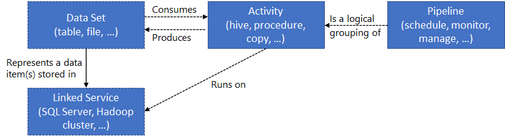
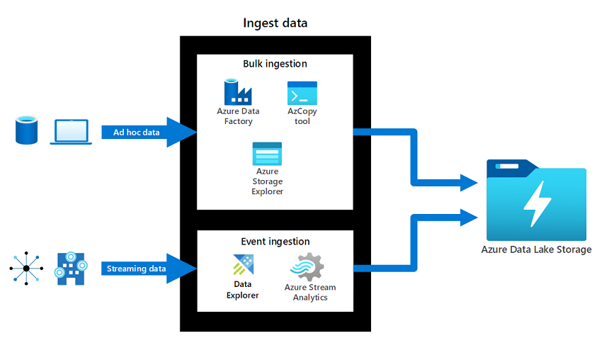
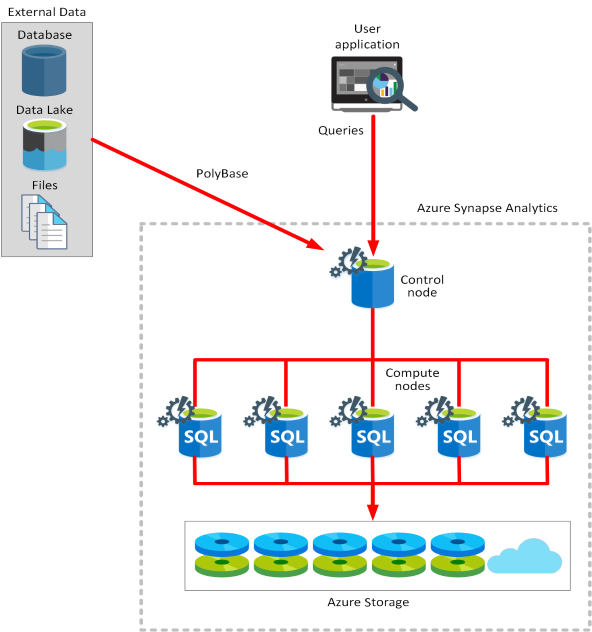
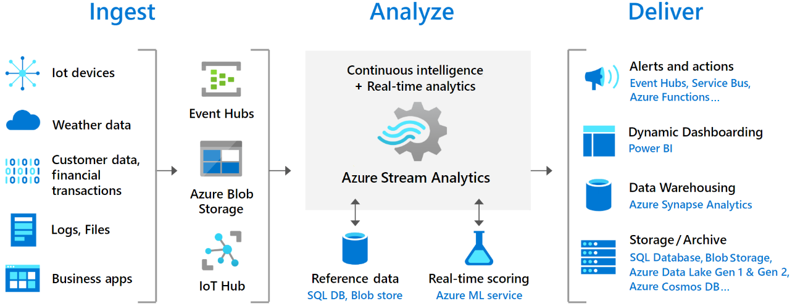

# Data integration

## Azure Data Factory (Pipeline)
1. Connect to SQLs, NoSQLs, SFTP, REST API, etc and collect data. First, ingest the data to collect all the data from different sources into a centralized location.
2. Transform and enrich. Next, transform the data by using a compute service like Azure Databricks and Azure HDInsight Hadoop.
3. Provide continuous integration and delivery (CI/CD) and publish. Support CI/CD by using GitHub and Azure Pipelines to deliver the ETL process incrementally before publishing the data to the analytics engine.
4. Monitor. Finally, use the Azure portal to monitor the pipeline for scheduled activities and for any failures.
5. Azure Data Factory serves two communities: 
    - the big data community
    - the relational data warehousing community that uses SQL Server Integration Services (SSIS). 

## Data Lake Factory (Big data store)
1. Azure Data Lake Storage can **store any type of data by using the data's native format**. With support for any data format and massive data sizes, Azure Data Lake Storage can work with structured, semi-structured, and unstructured data.
2. Azure Data Lake Storage utilizes **Azure Blob replication models**. These models support the same redundancy options available for Azure Blob Storage. Microsoft recommends ZRS for Azure Data Lake Storage workloads.
3. Access is like *Blob*, use *Azure Storage Explorer*.
4. Supports **hierarchical namespaces**.
5. Good for **large text data**.

## Azure Databricks (Transform data)
1. Have Control Plane and Compute Plane.
2. Azure Databricks is an analytics workspace built on Apache Spark.
3. Supports collaboration and handles both structured and streaming data.
4. Consider data science preparation of data. Create, clone, and edit clusters of complex, unstructured data. Turn the data clusters into specific jobs. Deliver the results to data scientists and data analysts for review.
5. Three environments:
   - **Databricks SQL**: Azure Databricks SQL provides an easy-to-use platform for analysts who want to run SQL queries on their data lake. You can create multiple visualization types to explore query results from different perspectives, and build and share dashboards.
    - **Databricks Data Science & Engineering**: Azure Databricks Data Science & Engineering lets data teams work together in an interactive workspace. Data is brought into Azure through batch or real-time tools like Azure Data Factory, Kafka, Event Hubs, or IoT Hub. Data is stored in Azure Blob Storage or Data Lake Storage. Databricks reads data from these sources and uses Spark to generate insights.
    - **Databricks Machine Learning**: Azure Databricks Machine Learning is an integrated end-to-end machine learning environment. It incorporates managed services for experiment tracking, model training, feature development and management, and feature and model serving.

### Difference with Data Factory.
1. Databricks is based on Spark sources needs a connector. ADF features a native **Stored Procedure Activity** designed specifically to invoke existing stored procedures in SQL Server, Azure SQL Database, or Azure Synapse Analytics. To get Azure Databricks to communicate with an on-premises database, you have to deploy Databricks into your own Virtual Network (VNet Injection) and set up a Site-to-Site VPN or ExpressRoute. ADF avoids all this networking overhead by simply installing a **Self-Hosted Integration Runtime (SHIR)** on a local server. - Hence in most exam this Databricks needs overheads.
2. Use Databricks when you need **Spark**, **Machine Learning**, **Big Data transformation**.

## Azure Synapse Link (for analytical data storage and analysis)

1. Azure Synapse Link allows you to run analytics in Azure Synapse Analytics on operational data from Azure Cosmos DB and Dynamics 365 in **near real-time**, without the need for complex ETL (Extract, Transform, Load) pipelines.
2. Breaks to:
    - Azure Synapse SQL pool: Choose between dedicated SQL pools for consistent performance and cost, or serverless SQL endpoints for flexible, on-demand workloads.
    - Azure Synapse Spark pool: Run Apache Spark clusters to process data using Python, Scala, SQL, or C#.
    - Azure Synapse Pipelines: Use cloud-based ETL workflows to move and transform data at scale, combining multiple sources if needed.
    - Azure Synapse Link: Connect to Azure Cosmos DB for near real-time analytics on operational data.

### Key Features

| Feature | Description |
| :--- | :--- |
| **Near Real-Time Analytics** | Data is continuously exported from operational stores (e.g., Cosmos DB) to Azure Synapse Analytics in near real-time (typically within 1–2 minutes) as data is ingested into the source. |
| **Zero ETL Pipelines** | Eliminates the need to create, manage, and maintain complex ETL pipelines, reducing development time and operational overhead. |
| **Cost-Effective** | Uses Azure Synapse Analytics Spark pools for querying and processing data, which are billed based on actual usage (pay-per-query) rather than pre-provisioned resources. |
| **Integration with Synapse Ecosystem** | seamlessly integrates with other Synapse Analytics components like SQL pools, data flows, and machine learning capabilities for comprehensive analytics workflows. |
| **Scalable Architecture** | Automatically scales to handle large volumes of data and concurrent queries without manual intervention. |
| **Secure by Design** | Inherits security and compliance features from both Azure Synapse Analytics and the source data stores, including encryption at rest and in transit, and granular access control. |

### How It Works

1. **Connect**: You create a Synapse Link service in Azure Synapse Studio that connects to your operational data store (e.g., Azure Cosmos DB).
2. **Enable**: You enable Synapse Link for your Cosmos DB database or specific containers. This creates a read-only, transactionally consistent copy of your data in Synapse.
3. **Query & Analyze**: Once enabled, the data becomes available in Synapse for analysis. You can use various tools within Synapse, such as:  
   - **Apache Spark notebooks**: For data exploration and advanced analytics  
   - **Synapse SQL**: For running SQL queries on the analytical data  
   - **Data flows**: For visual data transformation and orchestration  
   - **Machine learning**: For building and deploying ML models  
4. **Store**: The analytical data is stored in Azure Synapse Analytics in formats like Apache Parquet, optimized for analytical queries.

### Common Use Cases

- **Real-time operational analytics**: Monitor key business metrics and operational performance as data is generated.
- **Customer 360-degree view**: Combine transactional data with analytical insights to create comprehensive customer profiles.
- **Fraud detection**: Analyze transaction patterns in near real-time to detect and prevent fraudulent activities.
- **Supply chain optimization**: Track inventory levels and logistics in real-time for improved supply chain management.
- **Personalized recommendations**: Use real-time user behavior data to provide personalized recommendations.

### When to Use Synapse Link

| Scenario | Best Choice | Reason |
| :--- | :--- | :--- |
| **Near real-time analytics on operational data** | **Azure Synapse Link** | Provides seamless integration with minimal data movement and no complex ETL pipelines. |
| **Large-scale data warehousing** | Azure Synapse dedicated SQL pools | Optimized for complex queries on massive datasets with high concurrency. |
| **Data exploration and discovery** | Azure Databricks | Ideal for data scientists who need flexible environments for experimentation. |
| **Machine learning workflows** | Azure Databricks Machine Learning | Provides end-to-end ML capabilities including experiment tracking and model serving. |

### Key Takeaways for AZ-305

- Use Synapse Link for **near real-time analytics on operational data** (e.g., Cosmos DB) without ETL pipelines.
- It enables **cost-effective analytics** using Synapse Spark with pay-per-query billing.
- Synapse Link **eliminates data silos** by making operational data immediately available for analysis.
- It's ideal for use cases requiring **real-time insights** into operational data, such as fraud detection and personalized recommendations.
- Combine Synapse Link with other Synapse components (SQL pools, data flows, ML) for **comprehensive analytics workflows**.

## Difference

| Compare | Azure Data Factory | Azure Synapse Analytics
|-----------|-------------------|-------------------|
| Data sharing | Data can be shared across different data factories | Not supported |
| Solution templates | Solution templates are provided with the Azure Data Factory template gallery | Solution templates are provided in the Synapse Workspace Knowledge Center |
| Integration runtime **cross region** flows | Cross region data flows are supported | Not supported |
| Monitor data | Data monitoring is integrated with Azure Monitor | Diagnostic logs are available in Azure Monitor |
| Monitor Spark Jobs for data flow | Not supported | Spark Jobs can be monitored for data flow by using Synapse Spark pools |

## Design strategies for hot, warm, and cold data paths

| Scenario | Path solution |
|-----------|-------------------|
| Flexible support for data requirements that change frequently. Enable processing or displaying data in real time. | **Hot data path** |
| Support rarely used data, such as data stored for compliance or legal reasons. Enable consumption of data for long term analytics and batch processing. | **Cold data path** |
| Store or display a recent subset of data. Enable consumption of data for small analytical and batch processing. | **Warm data path** |

## Azure Stream Analytics (for stream analytics)

1. Use **Azure Stream Analytics** when you need to process data in motion from streaming sources like IoT devices, weblogs, or social media feeds and perform real-time analytics on that data.
2. It provides **built-in scalability** and **fault tolerance** for processing large volumes of streaming data in real time. Use **Azure Stream Analytics** to run queries on streaming data and produce output to various sinks like Azure SQL Database, Azure Data Lake Storage, or Azure Blob Storage.
3. Billing is done by Streaming Units (SUs).

