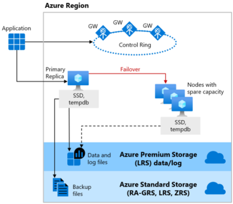
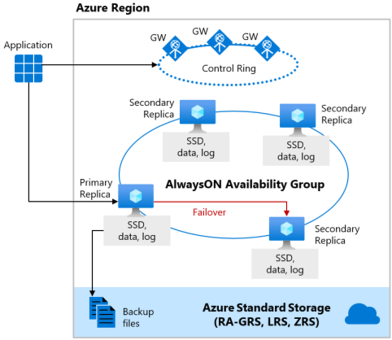

# Relational DB

## Types of SQL Server
1. Azure SQL Database: Paas but not 100% compatible with SQL Server. It has limited features of SQL Server.
2. SQL Server Managed Instance : Paas but 100% compatible with SQL Server. It has almost all features of SQL Server. Requires a VNet.
3. SQL Server on Azure VM: IaaS. Full control over the SQL Server.
4. Azure SQL Edge: SQL Server designed for IoT and edge devices.

### Azure SQL Database

1. vCore: A vCore is a virtual core. You choose the number of virtual cores and have greater control over your compute costs. This option supports the Azure Hybrid Benefit for SQL Server and reserved capacity (pay in advance).
2. DTU: A DTU (Database Transaction Unit) is a combined measure of compute, storage, and I/O resources. The DTU option is an easy, preconfigured purchase option.
3. Serverless: Split to:
    - General Purpose, automatically scales compute and charges for what you use.
    - Hyperscale, supports large storage, up to 100TB.
4. Elastic Database Pool: Buy a set of compute and storage resources to share among all SQL databases in an elastic pool. Good for **vertical scaling**. Example: have 5 databases, 2 are small, 3 are large. Pool them together.
5. Private link support.

### Azure Managed Instance Database
1. Either 
    - Single Instance, native network isolation
    - Instance Pool, shared resources for multiple instances, cost saving.
2. Best option for lift-and-shift migrations to Azure without having to redesign your applications. Can use *Log Shipping* so it's 0 downtime to migrate.
3. Uses vCores mode or General Purpose Next Gen.
4. For AI/Machine learning this is the option. 
5. Has SQL Server Agent, Common language runtime (CLR), Database Mail, Distributed transactions, and Machine Learning Services.

### Azure SQL on VM
- SQL Server access
- OS-level server access
- Expansive version support for SQL Server
- Expansive OS version support
- File stream, Microsoft Distributed Transaction Coordinator (DTC), and Simple Recovery model
- SQL Server Integration Services (SSIS), SQL Server Reporting Services (SSRS), and SQL Server Analysis Services (SSAS)

| Compare | SQL Database | SQL Managed Instance | SQL Server on Azure Virtual Machines |
| --- | --- | --- | --- |
| Scenarios | Best for modern cloud applications, hyperscale, or serverless configurations | Best for most lift-and-shift migrations to the cloud, instance-scoped features | Best for fast migrations, and applications that require OS-level access |

## Service Tier:
1. **General Purpose (GP)**: CPU, Memory, IOPS are balanced. Good for most workloads.
2. **Business Critical (BC)**: High IOPS, low latency. Good for OLTP. Able to failover.
3. **Hyperscale (HS)**: Large DB size, high availability. Good for Big Data. Takes minutes to recover.
  - The Hyperscale tier architecture uses paired page servers. You can scale horizontally to put all the data in caching layers.
  - The Hyperscale architecture supports databases as large as 128 TB.
  - meets read-scale requirements for business workloads

## Features:
1. **SQL Server Masking**: Dynamic data masking keeps sensitive data secure by masking it to non-privileged users. For example, you can mask credit card numbers so that only users with specific database roles can see the full number. 
2. **Threat Detection**: Monitors the database for suspicious activities and alerts you to potential threats. It can detect anomalies such as unusual login attempts, SQL injection attacks, and data exfiltration attempts. 
3. **Encryption**:
    - Deterministic encryption: Always generates the same encrypted value for the same plaintext value. Use this when you need to search or group by the encrypted column.
    - Randomized encryption: Generates a different encrypted value for the same plaintext value. Use this when you need to protect data from hackers, and you don't need to search or group by the encrypted column.
    - Always Encrypted

| Data state | Encryption method | Encryption level |
| --- | --- | --- |
| Data at rest | Transparent data encryption (TDE) | Always encrypted. |
| Data in motion | Transport Layer Security (TLS 1.2 or higher) | Always encrypted. |
| Data in process | Dynamic data masking | Specific data is unencrypted. Remaining data is encrypted. |

