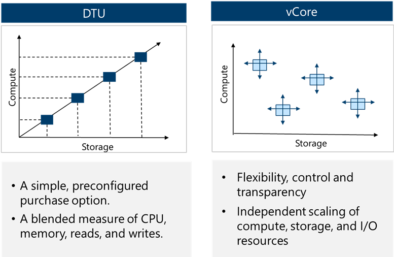
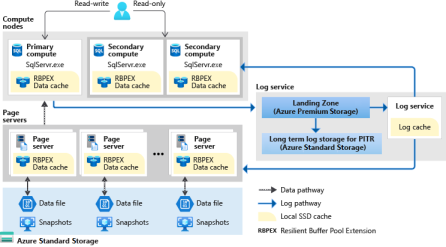

# Relational DB (Azure SQL)

> [!NOTE]
> **AZ-305 Exam Focus:** The exam tests selecting the appropriate Azure SQL deployment model (SQL DB vs. SQL MI vs. SQL on VM), purchasing & compute models (vCore vs. DTU, Serverless vs. Provisioned, Elastic Pools), high availability & disaster recovery (Failover Groups vs. Active Geo-Replication), backup retention (PITR vs. LTR), and security implementations (TDE, Always Encrypted, RLS, DDM, Ledger).

---

## 1. Deployment Models Decision Matrix

| Model | Scope & Architecture | Best For / Scenarios | Key Features & Limitations |
| :--- | :--- | :--- | :--- |
| **Azure SQL Database** | Database-scoped PaaS | Modern cloud-native apps, microservices, multi-tenant SaaS, intermittent workloads | • Fully managed, zero OS/instance overhead. • Supports Serverless & Elastic Pools. • No instance-scoped features (no native SQL Agent, no cross-database queries across servers without Elastic Query). |
| **Azure SQL Managed Instance** | Instance-scoped PaaS (nearly 100% surface-area compatibility) | Lift-and-shift of existing on-premises SQL Server with minimal application redesign | • Supports **SQL Server Agent**, **cross-database queries/transactions**, **Linked Servers**, **Service Broker**, and **CLR**. • Native `.bak` restore directly from Azure Blob Storage (`RESTORE ... FROM URL`). • Requires a dedicated, delegated subnet in a VNet. • Near-zero downtime migrations via **Azure DMS (online)**, **Managed Instance link**, or **Log Replay Service (LRS)**. • *Limitations:* No FileStream, no Simple Recovery model. |
| **SQL Server on Azure Virtual Machines** | IaaS (full OS & SQL control) | Legacy SQL versions (e.g., SQL 2008/2012 with free ESU), OS-level access, strict third-party software dependencies | • Full administrative control over VM and SQL instance. • Supports **FileStream**, **Simple Recovery model**, and co-located **SSAS / SSRS / SSIS**. • SQL Server IaaS Agent Extension enables automated patching, automated backups, and Azure Key Vault integration. • Customer is responsible for OS updates, patching, and high availability configuration. |
| **Azure SQL Edge** | Edge/IoT-optimized container | Low-latency streaming analytics on ARM64 and x64 edge devices | Built-in data streaming, time-series, and edge AI/graph analytics. |

---

## 2. Azure SQL Database: Purchasing & Compute Options

### Purchasing Models
1. **vCore (Recommended)**:
   - Independently configure and scale compute (vCores) and storage.
   - Supports **Azure Hybrid Benefit (AHB)** (up to 55% discount using on-premises SQL licenses with Software Assurance).
   - Supports **Reserved Capacity** (pre-pay for 1 or 3 years for steep discounts).
2. **DTU (Database Transaction Unit)**:
   - Bundled compute, storage, and I/O resources in fixed tiers (Basic, Standard, Premium).
   - Simpler, but lacks independent scaling, AHB, and Serverless options.

### Compute Tiers (vCore)
1. **Provisioned Compute**: Pre-allocates compute resources continuously billed per hour, whether used or not. Best for steady-state workloads.
2. **Serverless Compute**:
   - Automatically scales compute between configurable min and max vCores based on demand.
   - **Auto-pause & Auto-resume**: Automatically pauses the database during configured periods of inactivity (e.g., 1 hour), only billing for storage. Wakes up automatically on the next connection.
   - Billed per vCore-second. Ideal for intermittent, unpredictable, or dev/test workloads.

### Elastic Database Pools
- Buy a shared budget of compute resources (eDTUs or vCore pool) and storage shared across multiple databases.
- **AZ-305 Rule:** Designed for **multi-tenant SaaS patterns** where multiple databases have variable and unpredictable peak usage at different times. It is **NOT** for vertical scaling of single databases; it optimizes cost across many databases.

---

## 3. Service Tiers & High Availability Architecture

| Feature | General Purpose (GP) | Business Critical (BC) | Hyperscale (HS) |
| :--- | :--- | :--- | :--- |
| **Target Workload** | Most standard business workloads | High IOPS, low latency OLTP | Very large databases (VLDB), rapid scale |
| **Storage Architecture** | Remote Azure Premium Blob Storage (compute & storage decoupled) | Local NVMe SSD storage | Separated multi-tier caching with Page Servers & Log Service |
| **Max Database Size** | 4 TB (up to 128 TB on GP Next Gen) | 4 TB | **128 TB** |
| **High Availability Architecture** | Azure Service Fabric attaches a new stateless compute node to remote storage | **Always On Availability Groups** (4 replicas: 1 primary, 3 secondaries) with synchronous commit | Separated compute nodes + resilient distributed page servers |
| **Failover Time** | 1 – 2 minutes | Sub-second (fastest) | Rapid failover (seconds) |
| **Read Scale-Out** | Not supported | **1 free read-only replica** (connect using `ApplicationIntent=ReadOnly`) | Up to **30 named replicas** |
| **Backup / Restore Speed** | Proportional to database size | Proportional to database size | **Near-instantaneous** (storage snapshots regardless of size) |

### High Availability Architecture Diagrams

---

## 4. Disaster Recovery: Active Geo-Replication vs. Failover Groups

| Capability | Active Geo-Replication | Auto-Failover Groups (Failover Groups) |
| :--- | :--- | :--- |
| **Supported Offerings** | **Azure SQL Database only** | **Azure SQL Database AND SQL Managed Instance** |
| **Replication Scope** | Single database | Group of databases or entire Managed Instance |
| **Target Secondary** | Up to 4 readable secondaries across any Azure region | 1 secondary in a chosen paired/unpaired region |
| **Failover Process** | **Manual only** | **Automatic** (with configurable grace period) or **Manual** |
| **Connection Strings** | **Must be reconfigured** manually upon failover | **No change needed**; uses dedicated DNS listener endpoints (`-primary` and `-secondary`) |
| **Read Scale-Out** | Secondaries are readable | Secondary can be used as a read-only endpoint |

---

## 5. Backups & Business Continuity

1. **Automated Backups**:
   - Full backups: Weekly.
   - Differential backups: Every 12–24 hours.
   - Transaction log backups: Every 5–10 minutes.
2. **Point-in-Time Restore (PITR)**:
   - Restores a database to any point in time within the retention window.
   - Default: **7 days** (configurable from **1 to 35 days**).
3. **Long-Term Retention (LTR)**:
   - Stores full backups for regulatory compliance for up to **10 years** using Azure Backup vault policies (W-M-Y: Weekly, Monthly, Yearly).
4. **Backup Storage Redundancy**:
   - Configurable independently of compute tier: **LRS** (local), **ZRS** (zone), **GRS** (geo-redundant, default), or **GZRS**.

---

## 6. Security, Encryption & Compliance

| Security Area | Technology | Implementation & Exam Details |
| :--- | :--- | :--- |
| **Identity & Access** | **Microsoft Entra ID (Azure AD)** | Centralized identity management. Enables MFA, Conditional Access, and passwordless authentication via Managed Identities. |
| **Network Security** | **Private Link / Private Endpoint** | Secures access over private IP within the VNet, blocking public internet exposure. |
| **Data at Rest** | **Transparent Data Encryption (TDE)** | Encrypts database files, log files, and backups at rest using AES-256. Can use Service-Managed Keys or Customer-Managed Keys (BYOK via Azure Key Vault). |
| **Data in Transit** | **TLS 1.2+** | Enforces transport layer encryption between client applications and Azure SQL. |
| **Data in Use / Process** | **Always Encrypted** | Client driver encrypts sensitive columns before transmitting to database. Database processes ciphertext and never accesses plaintext. With **Secure Enclaves**, cryptographic operations (like equality/range queries) can occur inside hardware enclaves. |
| **Data in Use Encryption Types** | **Deterministic vs. Randomized** | • **Deterministic:** Always yields the same ciphertext for a given plaintext value; allows point lookups, joins, grouping, and indexing. • **Randomized:** Generates different ciphertext for identical plaintext; more secure, but prevents searching, grouping, and indexing. |
| **Presentation Layer** | **Dynamic Data Masking (DDM)** | **NOT encryption**. Obfuscates sensitive data in query results (e.g. `XXXX-XXXX-XXXX-1234` or custom masks) on the fly for non-privileged users without altering underlying data. |
| **Access Control** | **Row-Level Security (RLS)** | Uses SQL predicate functions to restrict which rows a user can see based on user identity or role (e.g., tenants can only access rows matching their TenantID). |
| **Audit & Integrity** | **Ledger for Azure SQL** | Provides cryptographic proof of data integrity using SHA-256 block hashing (tamper-evident tables and ledgers). Protects against unauthorized modifications even by high-privileged DBAs. |
| **Threat Protection** | **Microsoft Defender for SQL** | Vulnerability assessments, anomalous activity detection, and SQL injection alerting. |
