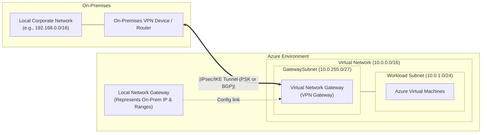
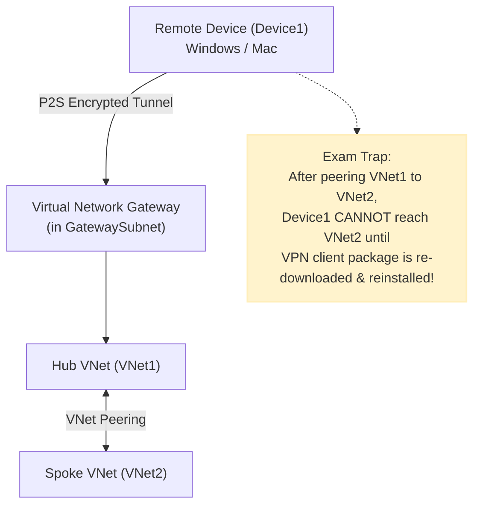
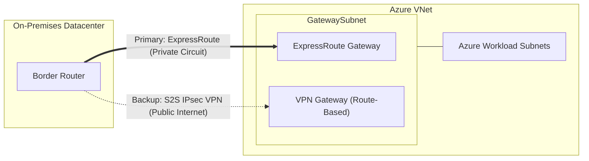
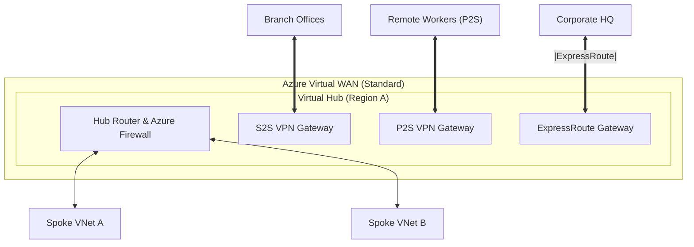

# Hybrid Networking: VPN & ExpressRoute

> [!NOTE]
> **Exam Relevance:** Both **AZ-104** and **AZ-305** heavily test Azure VPN Gateway (S2S, P2S, GatewaySubnet, and VNet Peering transit) and ExpressRoute. Azure Virtual WAN is covered in both, with deeper architectural design questions in AZ-305.

# VMA / Application Proxy
1. VPN are complex if seen below. Entra ID allows "Application Proxy".

2. Steps:

  - The user accesses the application through an endpoint and is redirected to the Microsoft Entra sign-in page.
  - Microsoft Entra ID sends a token to the user's client device after a successful sign-in.
  - The client sends the token to the application proxy service. The service retrieves the user principal name (UPN) and security principal name (SPN) from the token. The application proxy service then sends the request to the connector.
  - The connector performs required SSO authentication on behalf of the user.
  - The connector sends the request to the on-premises application.
  - The connector and application proxy service send the response to the user.

---

## 1. Core Connectivity Options Overview

| Service | Connection Type | Path / Medium | Bandwidth / Throughput | Typical Use Case |
| :--- | :--- | :--- | :--- | :--- |
| **Site-to-Site (S2S) VPN** | Branch-to-Azure | Encrypted IPsec/IKE over Public Internet | Up to 10 Gbps (VpnGw5) | Connecting on-premises branch/datacenter to Azure VNet |
| **Point-to-Site (P2S) VPN** | Device-to-Azure | Encrypted tunnel (OpenVPN, SSTP, IKEv2) over Internet | Up to 10 Gbps (shared) | Remote workers / road warriors accessing VNet resources |
| **ExpressRoute** | Enterprise-to-Azure | Private, dedicated connection via Exchange Provider (No public Internet) | Up to 100 Gbps (Direct) | Mission-critical, high-throughput, low-latency, SLA-backed hybrid connectivity |
| **Azure Virtual WAN** | Hub-and-Spoke Service | Unified Microsoft global backbone connecting S2S, P2S, ExpressRoute, and VNets | Up to 20 Gbps per hub | Centralized, large-scale enterprise global transit network |

---

## 2. Reference Diagrams

---

## 3. Site-to-Site (S2S) VPN

A Site-to-Site VPN connects an on-premises network to an Azure Virtual Network over an encrypted IPsec/IKE tunnel.

### Required Azure Components
1. **Virtual Network (VNet)**: The target network in Azure.
2. **GatewaySubnet**:

  - Must be named **exactly** `GatewaySubnet`.
  - Cannot contain workloads (VMs).
  - Recommended size: `/27` or `/28` (minimum `/29`).
  - Do **NOT** attach an NSG or UDR (with `0.0.0.0/0`) that blocks gateway management traffic.
3. **Virtual Network Gateway (VPN Gateway)**:

   - Gateway Type: `VPN` (vs `ExpressRoute`).
   - VPN Type: **Route-based** (recommended; supports IKEv2, P2S, BGP) vs **Policy-based** (legacy IKEv1, static IP ranges only).
   - Public IP Address: Standard SKU (Zone-redundant for `VpnGw#AZ` SKUs).
4. **Local Network Gateway (LNG)**:

   - Represents the **on-premises** VPN router/firewall in Azure.
   - Defines: On-premises public IP (or FQDN) and on-premises IP address prefixes (CIDR).
   - Contains on-prem BGP settings (ASN and BGP peer IP) if BGP is used.
5. **VPN Connection**:

   - The Azure resource that links the **Virtual Network Gateway** to the **Local Network Gateway**.
   - Configures the **Pre-Shared Key (PSK)** and IPsec/IKE policy.

### S2S Architecture Diagram

---

## 4. Point-to-Site (P2S) VPN

Connects individual client devices (Windows, macOS, Linux, iOS, Android) to an Azure VNet.

### Configuration
- Configured directly on the **Virtual Network Gateway** under **Point-to-site configuration**.
- **Address Pool**: Dedicated private IP range allocated to connected VPN clients (cannot overlap with VNet or on-premises ranges).
- **Protocols / Tunnels**:

  - **OpenVPN**: Cross-platform (Windows, Mac, Linux, mobile); supports Entra ID auth.
  - **SSTP**: Secure Sockets Tunneling Protocol (Windows-only, TCP 443 — passes easily through firewalls/proxies).
  - **IKEv2**: Fast, standards-based mobile/desktop VPN.
- **Authentication Methods**:

  1. **Azure Certificate Authentication**: Root certificate uploaded to Azure; client certificate installed on user machine.
  2. **Microsoft Entra ID (Azure AD)**: Modern user-based auth (MFA, Conditional Access). Requires OpenVPN tunnel and Azure VPN Client app.
  3. **RADIUS Authentication**: Integrates with on-premises Active Directory via Network Policy Server (NPS).

### ⚠️ Critical Exam Rule (Client Reinstallation)
> **P2S VPN Client Route Updates:**
> When virtual network peering is added or modified between VNets, **Windows P2S VPN clients do not automatically learn the new routes**.
> The VPN client configuration package **must be downloaded and reinstalled** on the client device to inject the updated route table.

---

## 5. Gateway SKUs & Feature Comparison

| Feature | Basic SKU (Legacy) | VpnGw1 - VpnGw5 (Gen 1 & Gen 2) | VpnGw1AZ - VpnGw5AZ |
| :--- | :--- | :--- | :--- |
| **Max Throughput** | 100 Mbps | 650 Mbps to 10 Gbps | 650 Mbps to 10 Gbps |
| **Max S2S Tunnels** | 10 | 30 | 30 |
| **Max P2S Connections** | 128 (SSTP only) | 250 to 1,000 (OpenVPN/IKEv2) | 250 to 1,000 |
| **BGP Support** | ❌ No | ✅ Yes | ✅ Yes |
| **Active-Active Resiliency** | ❌ No | ✅ Yes | ✅ Yes |
| **Zone Redundancy (AZ)** | ❌ No | ❌ No | ✅ Yes (Resilient to zone failure) |
| **IKE Protocols (S2S)** | IKEv1 only | IKEv1 & IKEv2 | IKEv1 & IKEv2 |

---

## 6. ExpressRoute & Coexistence

1. **ExpressRoute:**

  - Dedicated private connection via a Connectivity Partner (MPLS, Ethernet, or Cloud Exchange).
  - Does not travel over the public Internet.
  - Uses **BGP** for dynamic routing.
2. **ExpressRoute + VPN Gateway Coexistence (Failover):**

  - Both an ExpressRoute Gateway and a Route-Based VPN Gateway can coexist in the same `GatewaySubnet`.
  - The S2S VPN tunnel acts as a **backup / failover** if the ExpressRoute circuit fails.
  - By default, traffic prefers **ExpressRoute** over the VPN connection because ExpressRoute BGP routes are shorter/preferred.

---

## 7. Azure Virtual WAN (vWAN)

A managed, scalable hub-and-spoke networking service provided by Microsoft.

### Basic vs. Standard Virtual WAN

| Capability | Basic Virtual WAN | Standard Virtual WAN |
| :--- | :--- | :--- |
| **Supported Connections** | S2S VPN only | S2S VPN, P2S (User) VPN, ExpressRoute |
| **Hub-to-Spoke** | Single hub only | Multiple hubs across regions |
| **VNet-to-VNet Transit** | ❌ No | ✅ Yes (via virtual hub router) |
| **Custom Route Tables** | ❌ No | ✅ Yes |
| **Azure Firewall in Hub** | ❌ No | ✅ Yes (Secured Virtual Hub) |

