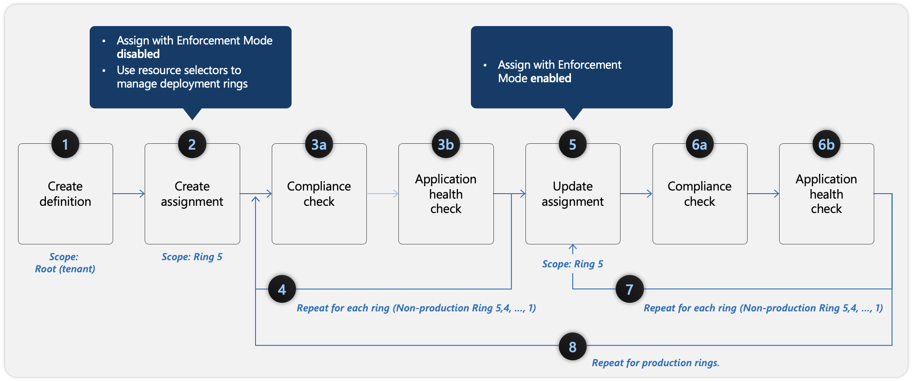

# Azure Policy
[Azure Policy](https://learn.microsoft.com/en-us/training/modules/sovereignty-policy-initiatives/azure-policy-design-principles)

1. The link above is much more concise. Read it first.

## General Concepts
1. Applies to Management Group, Subscription, and Resource Group. Can be up to Tenant Root.
1. New policy assigned will take 5-15 minutes to take effect.
2. Policy applied restricts new resource creation and updates, but will not affect existing resource creation and updates. To apply to existing resources, you need to run a remediation task.
3. Deny Policy always takes precedence over other policies.
4. Can be assigned up-to Management group level.
5. Enforment Mode: Disabled | Enabled. Disabled doesn't mean it won't apply. It means it won't apply to new resources. To apply to existing resources, you need to run a remediation task.
6. Exemptions: You can exempt a resource from a policy assignment. When exempted, Azure Policy skips the evaluation of that resource.
7. Attestation: You can create an attestation for a policy assignment. When attested, Azure Policy will evaluate the resource against the policy assignment.
8. Managed Policies: Policy definitions created and managed by Microsoft.
9. Custom Policies: Policy definitions created by users.
10. Policy Aliases: Policy definitions created by users that are not managed by Microsoft.

## Order
[Policy Effect](https://learn.microsoft.com/en-us/azure/governance/policy/concepts/effect-basics)

- disabled (no enforcement, but policy definition still exists)
- append (allow the policy to update or add new values. Only applied during resource creation.)
- modify (allow the policy to update or add new values. Only applied during resource creation.)
- deny (Deny policy always takes precedence over other policies. Not allowed to create or update resources.)
- audit (Audit policy will evaluate resource, and if the policy is not met, it will audit the resource.)
- auditIfNotExists (Audit policy will evaluate resource, and if the policy is not met, it will audit the resource.)
- deployIfNotExists (Deploy policy will evaluate resource, and if the policy is not met, it will deploy the resource. This is a policy that can be used to enforce compliance with other policies.)
- manualTrigger (Manual trigger policy will trigger the remediation task manually.)

## Remediation
Remediation is a process that allows you to apply a policy assignment to existing resources. When you create a policy assignment, it will not affect existing resources. To apply the policy assignment to existing resources, you need to run a remediation task.



## Policy Definition
1. Formally Microsoft Defender.
2. Break to:
  - mode: Determines which resource types the policy evaluates. Common values are All (evaluates resource groups, subscriptions, and all resources) or Indexed (evaluates only resource types that support tags and location).
  - parameters: Functions like variables in a script. It allows you to pass specific values (such as an array of allowed VM sizes) when you actually assign the policy, so you do not have to hardcode them into the definition.
  - policyRule: The core logic engine of the policy. It contains the If block (the conditions the policy checks) and the Then block (the effect triggered, such as Deny, Audit, or DeployIfNotExists).
  - metadata: Stores supplemental, descriptive information about the policy definition itself. By default, this includes things like the policy's category or version.
3. Sample
```json
{
"properties": {
"displayName": "Security - ERvNet - AuditRGLock",
"policyType": "Custom",
"mode": "All",
"description": "Audit required resource groups lock",
"metadata": {
  "securityCenter": {
    "RemediationDescription": "Resource Group locks can be set via Azure Portal -> Resource Group -> Locks",
    "Severity": "High"
 }
},
"parameters": {
  "expressRouteLockLevel": {
    "type": "String",
    "metadata": {
      "displayName": "Lock level",
      "description": "Required lock level for ExpressRoute resource groups."
    },
    "allowedValues": [
      "CanNotDelete",
      "ReadOnly"
    ]
  }
},
"policyRule": {
  "if": {
    "field": "type",
    "equals": "Microsoft.Resources/subscriptions/resourceGroups"
  },
  "then": {
    "effect": "auditIfNotExists",
    "details": {
      "type": "Microsoft.Authorization/locks",
      "existenceCondition": {
        "field": "Microsoft.Authorization/locks/level",
        "equals": "[parameters('expressRouteLockLevel')]"
      }
    }
  }
}
}
}
```
4. New way is to use KQL. See [link](https://learn.microsoft.com/en-us/azure/defender-for-cloud/create-custom-recommendations?pivots=azure-portal&tabs=database-firewall)
```
RawEntityMetadata
| where Environment == 'Azure' and Identifiers.Type =~ 'Microsoft.Sql/servers'
| extend condition = (isnull(Record.properties.publicNetworkAccess) or Record.properties.publicNetworkAccess != 'Disabled')
| extend HealthStatus = iff(condition, 'UNHEALTHY', 'HEALTHY')
| project Id, Name, Environment, Identifiers, AdditionalData, Record, HealthStatus
```