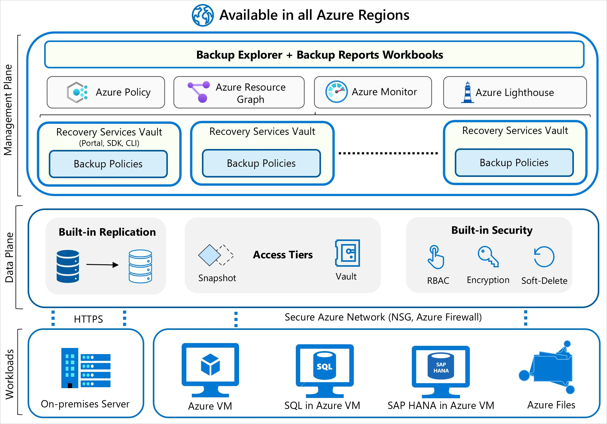

# Backup

## Backup locations
1. Azure Backup manages and stores backed-up data across **Recovery Services vaults** and **Backup vaults**. However, **not all backups physically move data into a vault**:
    - **Operational (Snapshot / Local) Tier**: The backup data remains locally in the source resource (e.g., local disk snapshots for VMs, or within the source storage account for Operational Blob Backup). The vault only orchestrates policies, jobs, and metadata.
    - **Vault Tier**: The backup data is physically transferred and stored in the vault's managed storage (e.g., Vaulted Blob Backup, Azure VM long-term retention).
2. For on-premises Windows machines, you can back up directly to Azure with the Azure Backup Microsoft Azure Recovery Services (MARS) agent. Alternatively, you can back up these Windows machines to a backup server, perhaps a System Center Data Protection Manager (DPM) or Microsoft Azure Backup Server (MABS). You can then back that server up to a Recovery Services vault in Azure.
3. In UI, this is called **Backup Center**. Backup center allows you to have a single pane of glass to manage all tasks related to backups. Backup center is designed to function well across a large and distributed Azure environment. You can use Backup center to efficiently manage backups spanning multiple workload types, vaults, subscriptions, regions, and Azure Lighthouse tenants.
4. **Recovery Services vault** and **Backup vault** are **different** ARM resource types with distinct workload support. Recovery Services vaults support Azure VMs, SQL/SAP HANA in VMs, Azure Files, on-premises machines (MARS/MABS), and Azure Site Recovery (ASR). Backup vaults support newer cloud-native and PaaS workloads such as Azure Managed Disks, Azure Blobs, AKS, and Azure Database for PostgreSQL. 


## Method


1. Workload integration layer - Backup Extension: Integration with the actual workload, such as Azure virtual machines (VMs) or Azure Blobs, happens at this layer.
2. Data Plane - Access Tiers: There are three access tiers where the backups could be stored:
    - Snapshot tier - The snapshot is taken and stored along with the disk.
    - Standard tier - Backup data for all workloads supported by Azure Backup is stored in vaults, which hold backup storage, an autoscaling set of storage accounts managed by Azure Backup.
    - Archive tier - The backup data is moved to an offline state in the archive tier. Azure Backup for storing backup data, including their Long-Term Retention (LTR) backup data, with retention needs defined in the organization's compliance rules. 
3. Data Plane - Availability and Security: The backup data is replicated across zones or regions, based on the redundancy the user specifies.
4. Management Plane – Recovery Services vault/Backup vault and Backup center: The vault provides an interface for the user to interact with the backup service.

## RTO
Recovery Time Objective (RTO) is the target time within which a business process must be restored after a disaster occurs to avoid unacceptable consequences. For instance, if a critical application goes down due to a server failure and the business can only tolerate a maximum of four hours of downtime, then the RTO is four hours.

## RPO
Recovery Point Objective (RPO) is the maximum amount of data loss, measured in time, that your organization can sustain during an event.

## Azure Backup can provide backup services for the following data assets:

- On-premises files, folders, and system state
- Azure Virtual Machines (VMs)
- Azure Managed Disks
- Azure Files Shares
- SQL Server in Azure VMs
- SAP HANA (High-performance Analytic Appliance) databases in Azure VMs
- Azure Database for PostgreSQL servers
- Azure Blobs
- Azure Database for PostgreSQL - Flexible servers
- Azure Database for MySQL - Flexible servers
- Azure Kubernetes cluster

### Support
Azure Backup supports the following scenarios:

- **Azure VMs** - Back up Windows or Linux Azure VMs
Azure Backup provides independent and isolated backups to guard against unintended destruction of the data on your VMs. Backups are stored in a Recovery Services vault with built-in management of recovery points. Configuration and scaling are simple, backups are optimized, and you can easily restore as needed.
- **On-premises** - Back up files, folders, and system state using the Microsoft Azure Recovery Services (MARS) agent. Or use Microsoft Azure Backup Server (MABS) or Data Protection Manager (DPM) server to protect on-premises VMs (Hyper-V and VMware) and other on-premises workloads.
- **Azure Files shares** - Azure Files provides snapshot management by Azure Backup.
- **SQL Server in Azure VMs and SAP HANA databases in Azure VMs** - Azure Backup offers stream-based, specialized solutions to back up SQL Server, or SAP HANA running in Azure VMs. These solutions take workload-aware backups that support different backup types such as full, differential and log, 15-minute RPO, and point-in-time recovery.

## Backup types

| Type | Description | Usage |
| --- | --- | --- |
| Full | A full database backup backs up the entire database. It contains all the data in a specific database or in a set of filegroups or files. A full backup also contains enough logs to recover that data. | At most, you can trigger one full backup per day. You can choose to make a full backup on a daily or weekly interval. |
| Differential | A differential backup is based on the most recent full-data backup. It captures only the data that changed since the full backup. | At most, you can trigger one differential backup per day. You can't configure a full backup and a differential backup on the same day. |
| Multiple backups per day | Back up Azure VMs hourly with a minimum recovery point objective (RPO) of 4 hours and a maximum of 24 hours. | You can use Enhanced backup policy to set the backup schedule to 4, 6, 8, 12, and 24 hours (respectively) for new Azure offerings, such as Trusted Launch VM. |
| Selective disk backup | Selectively back up a subset of the data disks that are attached to your VM, then restore a subset of the disks that are available in a recovery point, both from instant restore and vault tier. Selective disk backup helps you manage critical data in a subset of the VM disks and use database backup solutions when you want to back up only their OS disk to reduce cost. | Azure Backup provides Selective Disk backup and restore capability using Enhanced backup policy. |
| Transaction Log | A log backup enables point-in-time restoration up to a specific second. | At most, you can configure transactional log backups every 15 minutes. |

## Availability and Security
1. Azure Backup also provides protection against malicious deletion of your backup by using soft-delete operations. 
2. A deleted backup is stored for 14 days, free of charge, which allows you to recover the backup if needed.
3. You can choose from locally redundant storage (LRS), Geo-redundant storage (GRS), or zone-redundant storage (ZRS).
4. If your three Azure VMs are deployed across multiple subscriptions or regions, you should note that Azure Backup doesn’t support cross-region backup for most workloads. However, it does support cross-region restore in a paired secondary region.

## SQL Server
If your main concern is to only back up the SQL Server data, Azure Backup provides support for that as well. Azure Backup offers a stream-based, specialized solution to back up SQL Servers running in Azure VMs. This solution aligns with Azure Backup's benefits of zero-infrastructure backup, long-term retention, and central management.

Additionally, Azure Backup provides the following advantages specifically for SQL Server:
- Workload aware backups that support all backup types: full, differential, and log
- 15-minute recovery point objective (RPO) with frequent log backups
- Point-in-time recovery up to a second
- Individual database-level backup and restore

## Enhanced soft delete 
Enhanced soft delete is *enabled* by default for all Recovery Services vaults and Backup vaults. It protects against malicious or accidental deletion of backup data. Can be disabled for specific vaults and can turn _Always On_.

## Backup Policy
You can define the backup frequency and retention duration for your backups. Currently, the VM backup can be triggered daily or weekly, and can be stored for multiple years. The backup policy supports two access tiers: snapshot tier and the vault tier. By using the Enhanced policy, you can trigger hourly backups.

**Selective disk backup**: Azure Backup provides Selective Disk backup and restore capability using Enhanced policy. By using this capability, you can selectively back up a subset of the data disks that are attached to your VM. Then, you can restore a subset of the disks that are available in a recovery point, both from instant restore and vault tier. It helps you manage critical data in a subset of the VM disks and use database backup solutions when you want to back up only their OS disk to reduce cost.

**Snapshot tier**: All the snapshots are stored locally for a maximum period of five days, in what is called the snapshot tier. For all types of operation recoveries, we recommended that you restore from the snapshots because it's faster to do so. This capability is called instant restore.

**Vault tier**: All snapshots are additionally transferred to the vault for more security and longer retention. At this point, the recovery point type changes to "snapshot and vault."

## How VM is backed up
1. For Azure VMs that are selected for backup, Azure Backup starts a backup job according to the backup frequency you specify in the backup policy.
2. During the first backup, a backup extension is **automatically installed** by Azure Backup through the **Azure VM Guest Agent** (no manual installation needed):
    - **Windows VMs**: Installs the `VMSnapshot` extension (coordinates with Windows VSS for application-consistent backups).
    - **Linux VMs**: Installs the `VMSnapshotLinux` extension (coordinates with file system / pre-post scripts).
    - **Prerequisite**: The **Azure VM Guest Agent** must be installed and in a `Ready` state with outbound network access to Azure Backup endpoints (port 443).
    - **If the VM is stopped / deallocated**: Azure Backup still completes the backup! It captures an **agentless, crash-consistent backup** directly from the Azure storage fabric without needing the VM to run or the extension to be installed.
3. After the snapshot is taken, the data is stored locally (Snapshot tier) and transferred to the vault.
4. The backup is optimized by backing up each VM disk in parallel.
5. For each disk that's being backed up, Azure Backup reads the blocks on the disk and identifies and transfers only the data blocks that changed (the delta) since the previous backup.
6. Snapshot data might not be immediately copied to the vault. It might take several hours at peak times. Total backup time for a VM is less than 24 hours for daily backup policies.
7. Example below; backup of 5 days ago can instant restore, but backup of 6 days ago, vault restore is used.
```
The backup policy sub type is Standard, and the backup policy has the following configurations:

Backup schedule frequency: Weekly
Retain instant recovery snapshot(s) for: 15 days
Retention of weekly backup point: On Sunday at 8:00 AM for 12 weeks
```

### How On-Premises VMs are Backed Up (Comparison with Cloud VMs)

Unlike Azure VMs, **Azure cannot automatically push extensions to on-premises VMs** because they run outside the Azure Resource Manager fabric and do not have the Azure VM Guest Agent.

On-premises VMs are backed up using one of two approaches:

#### 1. Hypervisor-Level VM Backup using MABS (Microsoft Azure Backup Server) or DPM
When you want full VM-level and application-consistent backup for on-premises virtual environments:
- **Architecture**: A dedicated on-premises server running **MABS** (or System Center DPM) coordinates the backups.
- **For Hyper-V VMs**:
  - The MABS protection agent is installed on the **Hyper-V host server** (NOT inside individual guest VMs).
  - The agent captures VM snapshots host-side using the Hyper-V VSS writer.
- **For VMware VMs (vCenter / ESXi)**:
  - **Completely agentless!** No agent is installed on the ESXi host or inside guest VMs.
  - MABS communicates directly with the **vCenter Server** or **ESXi host** using native VMware vSphere APIs (VADP).
- **Data Flow**: On-premises VMs are backed up to **local attached disks on the MABS server first** (for fast local restore), and then offloaded to the **Azure Recovery Services Vault** for long-term retention.

#### 2. Guest OS-Level Backup using MARS Agent (No Backup Server)
If you do not want to deploy a dedicated MABS server:
- You must **manually install the MARS Agent** directly inside each Windows guest OS.
- Backs up **Files, Folders, and System State** directly over HTTPS to the **Azure Recovery Services Vault**.
- **Limitation**: Does NOT support full VM image backup, bare metal recovery, or Linux workloads; cannot do hypervisor-level snapshots.

#### Cloud vs. On-Premises VM Backup Comparison

| Feature / Aspect | Azure VMs (Cloud) | On-Prem Hyper-V (via MABS) | On-Prem VMware (via MABS) | On-Prem Windows (via MARS) |
| :--- | :--- | :--- | :--- | :--- |
| **Backup Extension / Agent** | **Auto-installed extension** via Azure VM Guest Agent | Agent installed on **Hyper-V Host** | **Agentless** (via vCenter APIs) | **Manually installed** in Guest OS |
| **Agent inside Guest VM?** | No (only pre-installed Guest Agent) | **No** | **No** | **Yes** (MARS agent) |
| **Dedicated Backup Server?** | **No** (Zero-infrastructure BaaS) | **Yes** (MABS / DPM on-premises) | **Yes** (MABS / DPM on-premises) | **No** (Direct to cloud) |
| **Initial Backup Destination** | Snapshot Tier (Local) + Vault | Local MABS disk (operational) | Local MABS disk (operational) | Recovery Services Vault |
| **Offsite Long-Term Storage** | Recovery Services Vault | Recovery Services Vault | Recovery Services Vault | Recovery Services Vault |
| **Recovery Granularity** | Full VM, Disks, or Files | Full VM, Disks, Files, Apps | Full VM, Disks, Files, Apps | Files, folders, system state |


## Restore VM
[Restore a VM](https://learn.microsoft.com/en-us/azure/backup/backup-azure-arm-restore-vms).

1. Backup for VM are only for the same Region and OS. But backup for SQL Server can be restore to different region.
2. If restore VM:
    - Restore to same region. 
    - Restore to different region, must make sure the OS is same.
3. If restore VM to different region, you need to provide a new
    - Network interface
    - Private IP
    - Public IP
    - Availability set/zone
    - VNet
    - Subnet
    - Resource Group
    - Name (New)
    - Storage Account for disk 
    - Disk Type
4. If restore OS disk only, you can:
    - Restore to same region. 
    - Restore to different region, must make sure the OS is same.
5. If restore OS disk only to different region:
    - No VNet, no Subnet, no Public IP, no Private IP
    - Resource Group
    - Name (New)
    - Storage Account for disk 
    - Disk Type
6. Replacing existing disk, the VM must be stopped and the disk must be unattached from the VM. The VM must exists.
    - Replacing existing disk with encryption are not supported.
7. Encrypted VM cannot be restored to another region, because it require the key to decrypt. Unless using Azure Disk Encryption. 

## Deleting Vault
1. You cannot delete a Resource Group that has vault backup
2. Vault backup cannot be deleted when
    - requires to stop backup
    - if data has retention/protected data
    - if soft delete is turned on. Require to disable soft-delete, delete all data then delete soft-delete datas.
    
## Data Box
1. Types
    - DataBox Disk - up to 10TB
    - DataBox - up to 80TB
    - DataBox Heavy - 1 PB
    - DataBox Go - up to 30TB

### Import Procedure
1. Create in Azure Portal a Ticket
2. Copy data to Data Box using WAImport/Export Tool
    - Either specify dataset.csv and driveset.csv to copy file. 
    - Can specify encryption, e.g. Bitlocker.
3. Ship back to Microsoft
4. Microsoft upload data to Azure
5. Update in Azure Portal

### Export Procedure
1. Create Azure Portal a job
2. Select a container (only Blob allowed)
3. Add address in portal to ship
4. Microsoft ships Data Box to you
5. Update Azure Portal
6. Optional - Copy data from Data Box using WAImport/Export ToolZ

## Recovery Service Vault
1. To recover specific file, this is the portal.
2. Default GRS backup.
3. A Log must be created for Recovery Service Vault, it can be:
    - Log Analytics Workspace (any Region)  OR
    - Storage Account (must in same region as Recovery Service Vault)
4. Minimum 30 days retention. 
5. **Backup Vault is NOT a subset of Recovery Services Vault** — they are two distinct ARM resources under different resource providers (`Microsoft.RecoveryServices/vaults` vs `Microsoft.DataProtection/backupVaults`) managing different sets of workloads.

## To delete Vault
1. Stop Backup
2. Delete all the data
3. Disable soft delete
4. Delete all soft delete data
5. Delete Backup Vault
6. Delete Logs (optional)
7. Delete Recovery Service Vault / Resource Group

## Azure Site Recovery
1. This is not related to backup/restore. This is for Disaster Recovery.
2. Requires a Recovery Service Vault.
3. Can be configured in two ways:
    - Azure to Azure
    - On-premises to Azure, requires MARS and MABS
    - MARS is the agent installed on the on-premises machine to back up files, folders, and system state. MABS is on VM/Hyper-machines to backup to MARS. 
4. For on-premises to Azure, need to install **Mobility service** on the on-premises machine. (No agent for Azure to Azure)
5. Can use Azure Site Recovery on an Azure VM (in different region) to replicate to another region. But take not NSG or public address are not created.
6. For Hyper-V on-premises, need to install **Azure Site Recovery Provider** and **Azure Recovery Services Agent** on the on-premises Hyper-V host. A new Hyper-V site is required to be created for recovery.
7. Recovery goal defines the RPO (Recovery Point Objective).
8. Each site requires a new VNet and Resource Group. During setup both have different VNet and Subnet and during disaster recovery it knows where to enable and during backup it knows where to store. Public IP also needs to change as ip address are region based. **DNS must also be updated to the new public IP**, so use traffic manager/front door in these cases.

### Testing failover
    a. Test failover;
        - Create a new RPO (Recovery Point Objective)
        - Create a new VM from the recovery point
    b. Commit;
        - Failover to a new region
    c. Reprotect;
        - Failover back to primary region

### Planned failover
    a. Planned failover;
        - Stop the VM
        - Create a new RPO (Recovery Point Objective)
        - Create a new VM from the recovery point
    b. Commit;
        - Failover to a new region, do not create new VM, just power on the VM.
        - Commit the failover so recovery point is cleaned up.


### Backup & Recovery Agents
1. **MARS Agent (Azure Backup Agent)**:
   - Lightweight agent installed directly on target machines.
   - Backs up **Files, Folders, and System State** directly to Azure Recovery Services Vault.
   - No separate backup server needed; Windows only (up to 3 backups/day).
2. **MABS (Microsoft Azure Backup Server)**:
   - Dedicated on-premises backup server (requires local storage).
   - Supports **Application-aware workloads** (SQL, Exchange, SharePoint), **Hyper-V/VMware VMs**, and **Bare Metal Recovery**.
   - Backs up locally first, then offloads to Azure (uses MARS agent internally to replicate to the vault).
3. **Azure Site Recovery (ASR) Mobility Service / Provider**:
   - Used for disaster recovery and VM replication to Azure (not traditional backup).

## Extra AZ-305

### 1. Disambiguating Confusing Terminology: Service vs. Vaults vs. Server vs. DR

| Term / Component | Type | What it actually is & Where it runs | Key Workloads Supported |
| :--- | :--- | :--- | :--- |
| **Azure Backup** | Managed Cloud Service | The umbrella Backup-as-a-Service (BaaS) provided by Microsoft for cloud and hybrid data protection. | All supported Azure and hybrid backup workloads. |
| **Recovery Services Vault** (`Microsoft.RecoveryServices/vaults`) | Azure ARM Resource (Cloud Vault) | The traditional, mature vault for IaaS VMs, databases in VMs, files, hybrid backup, AND Disaster Recovery. | **Azure VMs**, **SQL Server in Azure VMs**, **SAP HANA in Azure VMs**, **Azure Files**, on-prem via **MARS/MABS**, and **Azure Site Recovery (ASR)**. |
| **Backup Vault** (`Microsoft.DataProtection/backupVaults`) | Azure ARM Resource (Cloud Vault) | The newer ARM resource designed specifically for modern cloud-native, PaaS, and containerized workloads. | **Azure Managed Disks**, **Azure Blobs** (operational & vaulted), **Azure Database for PostgreSQL (Flexible Server)**, **Azure Kubernetes Service (AKS)**, MySQL Flexible. |
| **Microsoft Azure Backup Server (MABS)** | Software Server / VM Appliance | An on-premises backup server application (customized System Center DPM). Backs up locally to disk first, then offloads long-term copies to Azure. | On-premises Hyper-V, VMware, Windows Server, SQL, Exchange, SharePoint, Bare Metal Recovery (BMR). Sends data to a **Recovery Services Vault** via embedded MARS. |
| **MARS Agent** (Azure Recovery Services Agent) | Lightweight Software Agent | Installed directly on a Windows OS (on-premises or VM). Backs up files, folders, and system state directly to Azure without requiring a backup server. | Files, folders, and system state on Windows. Writes to a **Recovery Services Vault**. |
| **Azure Site Recovery (ASR)** | Disaster Recovery Service (DRaaS) | Continuous replication and failover orchestration service for Business Continuity and Disaster Recovery (BCDR). **Not a traditional backup**. | Azure-to-Azure VM replication, VMware/Hyper-V/Physical-to-Azure replication. Managed inside a **Recovery Services Vault** (never Backup Vault). |
| **Azure Backup Center** | Portal Management Plane | A unified "single pane of glass" interface across subscriptions, regions, and tenants to manage both Recovery Services vaults and Backup vaults. | Centralized monitoring, governance, auditing, and backup policies across all vaults. |

> [!IMPORTANT]
> **Summary Rules of Thumb:**

1. **Backup Vault != Backup Server**: A *Backup Vault* is a cloud storage resource in Azure for modern workloads (Blobs, Disks, AKS). A *Backup Server (MABS)* is an on-premises physical or virtual machine running backup server software.
2. **Backup Vault is NOT a subset of Recovery Services Vault**: They are distinct ARM resources provided by different resource providers (`Microsoft.DataProtection` vs `Microsoft.RecoveryServices`).
3. **Azure VMs use Recovery Services Vault, NOT Backup Vault**: Standalone Azure Managed Disks use Backup Vault, but full Azure VMs use Recovery Services Vault.
4. **Azure SQL Database (PaaS) does NOT use Recovery Services Vault**: PaaS Azure SQL has automated continuous backups built directly into the service (stored in managed Azure Storage accounts). Recovery Services Vault is only used for **SQL Server installed inside Azure IaaS VMs**.

---

### 2. Workload-to-Vault Decision Matrix (Exam High-Priority)

| Workload | Required Vault Type | Backup Mechanism / Agent | Target Storage Tiers | Key Architectural Notes |
| :--- | :--- | :--- | :--- | :--- |
| **Azure Virtual Machines (IaaS)** | **Recovery Services Vault** | Native agentless via VM Snapshot extension | Snapshot Tier (Instant Restore: 1–5 days) + Vault Tier | Standard policy (daily) vs Enhanced policy (hourly, Trusted Launch, Ultra Disks). |
| **Azure Managed Disks** | **Backup Vault** | Agentless cloud-native disk snapshots | Operational Tier (snapshots) + Vault Tier | Can back up OS and data disks independently of VM state. |
| **Azure Blob Storage** | **Backup Vault** | Continuous operational backup (native) or Vaulted backup | Operational Tier (PITR) + Vault Tier (offsite retention) | Operational backup uses point-in-time restore, object replication, and blob versioning without moving data. |
| **Azure Files (File Shares)** | **Recovery Services Vault** | Native file share snapshots + Vault tier | Snapshot Tier + Vault (Standard) Tier | Metadata in vault; supports soft delete (enabled automatically). |
| **SQL Server in Azure VM** | **Recovery Services Vault** | `AzureBackupWindowsWorkload` extension | Vault Tier (Full, Differential, Log) | 15-min RPO, point-in-time recovery, individual DB restore. |
| **SAP HANA in Azure VM** | **Recovery Services Vault** | Workload backup plugin | Vault Tier (Full, Differential, Incremental, Log) | Backint certified, streaming backup. |
| **Azure Database for PostgreSQL (Flexible)** | **Backup Vault** | Native cloud PaaS integration | Vault Tier | Scheduled automated backups and long-term retention. |
| **Azure Kubernetes Service (AKS)** | **Backup Vault** | Backup Extension (Velero-based) | Operational Tier (Disk snapshots) + Vault Tier (blob storage) | Backs up cluster configuration, Kubernetes resources, and CSI persistent volumes. |
| **Azure SQL Database (PaaS)** | **None (Native PaaS)** | Built-in automated backups | Azure Storage (LRS/ZRS/GRS) | Managed directly in Azure SQL service: 1–35 days PITR + Long-Term Retention (LTR) up to 10 years. |
| **On-Premises Files / System State** | **Recovery Services Vault** | MARS Agent (Windows only) | Vault Tier directly | No local staging disk needed; max 3 backups/day. |
| **On-Premises VMs & Enterprise Apps** | **Recovery Services Vault** | MABS or System Center DPM | Local disk (short-term) + Vault Tier (long-term) | Application-aware (Exchange, SharePoint, SQL, Hyper-V, VMware). |
| **Disaster Recovery (VM Replication)** | **Recovery Services Vault** | Azure Site Recovery (ASR) | Replicated target managed disks / cache storage | Near real-time continuous replication, planned/unplanned failover orchestration. |

---

### 3. Detailed Comparison: Recovery Services Vault vs. Backup Vault

| Feature / Dimension | Recovery Services Vault (`Microsoft.RecoveryServices`) | Backup Vault (`Microsoft.DataProtection`) |
| :--- | :--- | :--- |
| **Introduction** | Traditional / mature Azure vault | Modern, cloud-native vault |
| **Target Workloads** | IaaS VMs, SQL/SAP HANA in VMs, Azure Files, Hybrid (MARS/MABS) | Azure Disks, Blobs, AKS, PostgreSQL Flexible Server, MySQL Flexible |
| **Azure Site Recovery (ASR)** | **Yes** (integrated DR management) | **No** (ASR is not supported) |
| **Azure VM Backup** | **Yes** (Agentless VM extension) | **No** (Cannot back up Azure VMs) |
| **Storage Redundancy** | LRS, GRS (default), ZRS, Cross-Region Restore (CRR) | LRS, GRS, ZRS, Cross-Region Restore (CRR) |
| **Access Tiers** | Snapshot (Instant Restore), Vault Standard, Vault Archive | Operational (Snapshot/Local), Vault Standard, Vault Archive |
| **Soft Delete** | Enhanced Soft Delete (14–180 days, Always-On option) | Enhanced Soft Delete (14–180 days, Always-On option) |
| **Security & Immutability** | Immutable vault, Multi-User Authorization (MUA via Resource Guard) | Immutable vault, Multi-User Authorization (MUA via Resource Guard) |
| **Management** | Centralized via Azure Backup Center | Centralized via Azure Backup Center |

---

### 4. VM Backup Policies: Standard vs. Enhanced Policy

| Capability | Standard Backup Policy | Enhanced Backup Policy |
| :--- | :--- | :--- |
| **Backup Frequency** | Daily (once per day) or Weekly | Hourly (every 4, 6, 8, 12, or 24 hours) |
| **RPO** | 24 hours | 4 hours minimum |
| **Instant Restore Retention** | 1 to 5 days | 1 to 30 days |
| **Trusted Launch VMs** | Not supported via Azure Portal configuration | **Supported** (Mandatory for Trusted Launch VM backup) |
| **Disk Types Supported** | Standard HDD, Standard SSD, Premium SSD | **All types**, including **Ultra Disks** and **Premium SSD v2** |
| **Snapshot Resilience** | Zone-redundant snapshots not supported | **Supports Zone-Redundant (ZRS) snapshots** |
| **Consistency Tier** | Crash-consistent or Application-consistent | Agentless crash-consistent multi-disk backups |
| **Selective Disk Backup** | Supported | Supported (Exclude OS or specific data disks) |

---

### 5. Architecture: Replication vs. Disaster Recovery vs. Backup

In the AZ-305 exam, questions test your ability to design the appropriate resilience strategy:

```
+---------------------------------------------------------------------------------------+
|                                    BUSINESS CONTINUITY                                |
+---------------------------+-----------------------------------+-----------------------+
|       HIGH AVAILABILITY   |        DISASTER RECOVERY          |        BACKUP         |
|         (Replication)     |              (ASR)                |    (Azure Backup)     |
+---------------------------+-----------------------------------+-----------------------+
| Hardware/zone failure     | Major regional outage             | Accidental deletion,  |
| Zero RPO, zero/instant RTO| Low RPO (seconds/mins), low RTO   | ransomware, corruption|
| Synchronous/Async storage | Continuous replication + failover | Point-in-time recovery|
| Examples: ZRS, GRS, SQL AG| Examples: Azure Site Recovery     | Retention for years   |
+---------------------------+-----------------------------------+-----------------------+
```

1. **Replication is NOT Backup**:
   - Storage replication (LRS, ZRS, GRS) replicates data synchronously or asynchronously.
   - If a file is deleted, infected by ransomware, or corrupted, **the deletion or corruption is immediately replicated** to all redundant copies!
   - Replication provides high availability against infrastructure hardware failures, **not** data protection.
2. **Disaster Recovery (ASR) vs. Backup**:
   - **Azure Site Recovery (ASR)**: Keeps workloads running during datacenter/regional disasters by continuously replicating VM disk changes to a secondary region. It orchestrates failover so services can resume quickly (focus: **RTO**).
   - **Azure Backup**: Takes discrete point-in-time snapshots and streaming dumps, storing them with long-term retention policies for compliance and data restoration (focus: **Historical RPO & Long-Term Retention**).
3. **PaaS Database Strategy (Azure SQL)**:
   - For High Availability & DR: Use **Active Geo-Replication** (up to 4 readable secondaries) or **Auto-Failover Groups** (automatic failover with read-write listener endpoint).
   - For Backup: Use Azure SQL's built-in **Point-in-Time Restore (PITR)** (1–35 days) and **Long-Term Retention (LTR)** policies (up to 10 years).

---

### 6. Availability, Recovery, and SLA Metrics

#### Availability Metrics
- **Mean Time to Recovery (MTTR)**: Average time required to repair or restore a failed component after an outage
  MTTR = Total Maintenance/Downtime * Number of Failures
- **Mean Time Between Failures (MTBF)**: Average operational time between inherent system failures.
  MTBF = Total Operational Uptime * Number of Failures
- **Mean Time to Failure (MTTF)**: Expected lifespan of a non-repairable component until its first failure.

#### Recovery Metrics
- **Recovery Time Objective (RTO)**: Maximum acceptable duration of application downtime after an incident. Dictates how fast failover or recovery procedures must complete.
- **Recovery Point Objective (RPO)**: Maximum acceptable duration of data loss, measured in time. Dictates backup frequency and replication latency (e.g., 15-minute log backup = 15-minute RPO).
- **Recovery Level Objective (RLO)**: Granularity of the recovered data (e.g., entire VM, single database, specific table, or individual file/item).

#### Composite SLA Calculations
Azure provides SLAs for individual services (e.g., VM 99.99% with multi-zone, Azure SQL 99.99%). In system architecture:
- **Serial Components (Dependencies in Series)**: If Component A and Component B must both be online, multiply their SLAs:
  Composite SLA = SLA_A X SLA_B
  *Example:* Web App (99.95%) X Azure SQL (99.99%) = 0.9995 X 0.9999 = 99.94% (Composite availability is *lower* than individual components).
- **Parallel / Redundant Components (Failover in Parallel)**: If redundant instances run in parallel with automatic failover:
  Composite SLA = 1 - (1 - SLA_A) X (1 - SLA_B)
  *Example:* Two independent VMs in parallel (each 99.9%): 1 - (0.001 X 0.001) = 1 - 0.000001 = 99.9999% (Composite availability is *higher*).

---

### 7. Security and Governance for Vaults (AZ-305 Architecture)

1. **Multi-User Authorization (MUA) with Resource Guard**:
   - Protects against malicious insiders or compromised administrator accounts.
   - Critical operations (e.g., disabling soft delete, reducing retention duration, modifying backup policies, or deleting backup data) require authorization from a secondary administrator holding the **Resource Guard** resource.
   - The backup admin does NOT have permissions on the Resource Guard, enforcing separation of duties.
2. **Enhanced Soft Delete & Always-On Soft Delete**:
   - Soft delete retains deleted backup data for a customizable period (14 to 180 days) at no extra cost for the first 14 days.
   - **Always-On Soft Delete**: When enabled, soft delete **cannot be turned off** by any user (including subscription owners), permanently preventing ransomware from wiping backups before encrypting primary data.
3. **Immutable Vaults**:
   - Locks backup data using WORM (Write Once, Read Many) storage immutability.
   - Prevents backup recovery points from being deleted or modified before their retention period expires, even by Microsoft Support.
    
    