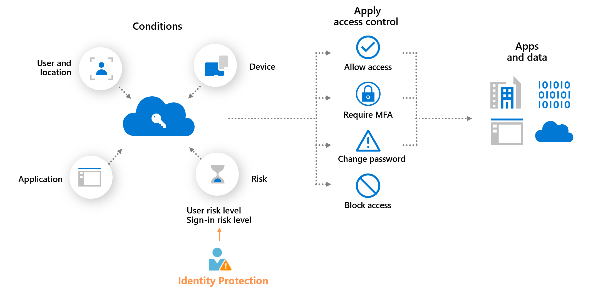

# User

## User Identities
  - Guest - invited
  - Member - created in Entra ID / synch from AD
(Can create in - portal * have departments etc..- MS365 * which have license set etc, still can see in portal- entra * also can add license, have departments etc similar to portal)

## Service Principal
    - Create automatically
    - Application Authentication

## Managed Identities
  - System assigned * tied to resources
  - User-assigned, assigned to a group to a person

### System assigned
When you toggle "System Assigned" to "On," Azure automatically:
* Creates an Enterprise Application / Service Principal in your Entra ID tenant.
* Names it exactly the same as your Azure Container App.
* Gives it a unique Object (Principal) ID.
* Only difference that there is no clientID + password
Managed Identity is designed for an Active Resource (the one running code, like a Container App or VM) to prove its identity to a Passive Resource (the one holding data, like Cosmos DB).Interesting we can do a Container App to Container App with Managed Identity too.

### User-assigned
Maintains a group of users that can be assigned to a resource. Similar to system assigned, but you maintain it as a group.

## Device Identities
- Entra AD joined * direct device
- Hybrid AD join * device via Active Directory
- Entra registered * Bring your own device

## Groups
- MS 365
- Distribution Group
- Mail-enable security
- Security group

## Membership types
- Assigned
- Dynamic membership
- Dynamic devices

## Dynamic membership rules
E.g. department = sales

## License
- P1 and P2
- Suite is a package that need P1/P2 - add security but almost the same as P2
- Can only be assigned in 365admin/entra portal

## Privileged Identity Management (PIM)
- Just-in-time access
- Approval workflow
- Time-bound access
- Audit trail

## Microsoft Graph
- this is an API to connect to Entra
- e.g `az ad create user` or via Powershell [`New-MgUser`](https://learn.microsoft.com/en-us/powershell/module/microsoft.graph.users/new-mguser?view=graph-powershell-1.0)

## AZ-305 Exam

### Identity Protection / Risk Policy

1. This is under SIEM and can be exported to MS Sentinel.
2. Configurable in Conditional Access with P2 license [Policy](https://learn.microsoft.com/en-us/entra/id-protection/howto-identity-protection-configure-risk-policies)
  - User risk policy
  - Sign-in risk policy
3. **User risk** represents the probability that a given identity or account is compromised. An example is when a user's valid credentials are leaked. User risks are calculated offline by using Microsoft's internal and external threat intelligence sources. Here are some user risks that can be identified:
  - **Leaked credentials**: Microsoft checks for leaked credentials from the dark web, paste sites, or other sources. These leaked credentials are checked against Microsoft Entra users' current valid credentials for valid matches.
  - **Microsoft Entra threat intelligence**: This risk detection type indicates user activity that's unusual for the given user or is consistent with known attack patterns.
4. **Sign-in risk** represents the probability that a given sign-in (authentication request) isn't authorized by the identity owner. Sign-in risk can be calculated in real time or offline. Here are some sign-in risks that can be identified:
  - **Anonymous IP address**: A sign-in attempt from an anonymous IP address like a Tor browser or an anonymized VPN.
  - **Atypical travel**: Two sign-ins from the same user that originate from a geographically distant location. Given past behavior, at least one of the locations might also be atypical for the user.
  - **Malicious IP address**: Sign-in from an IP with high failure rates due to invalid credentials or known bad IP reputation.
  - **Password spray**: A password spray attack is where multiple identities are attacked using common passwords in a unified brute force manner.
  - **Anomalous token**: Abnormal token characteristics, such as unusual lifetime or token played from an unfamiliar location.
  - **Verified threat actor IP**: Sign-in from an IP associated with known nation-state or cybercriminal threat actors.