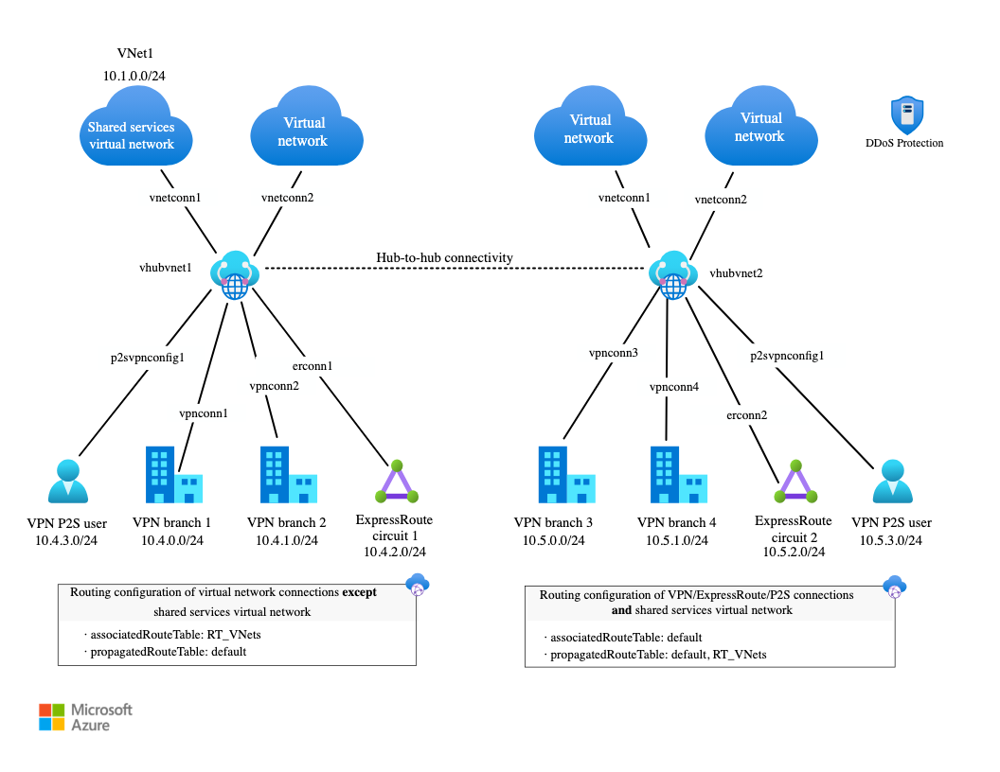
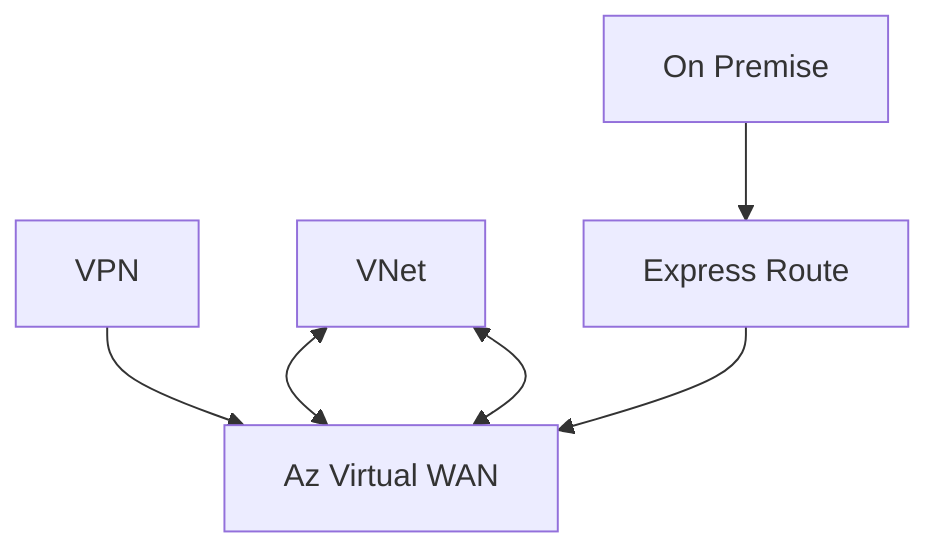

# VPN
1. This is more to Azure Virtual WAN. Coverage of AZ-305 not AZ-104. Objective is for On-Premises to Azure connectivity.
2. General Overview:
    - Azure VPN Gateway - Type of virtual network gateway that sends encrypted traffic between an Azure virtual network and an on-premises location.
    - Azure Express Route - Azure ExpressRoute uses a private, dedicated connection through a non-Microsoft connectivity provider. The connection is established using a partner that has a direct peering with Microsoft. (Note: express route with VPN failover is more for high availability)
    - Azure Virtual WAN - centrally manage site-to-site VPN connections 
    - Hub & Spoke (modern Virtual WAN) -  Hub & Spoke is a network topology that uses a central hub to connect multiple spokes, which are virtual networks that are connected to the hub

## Diagram




## SKU for VPN Gateway
1. Usage
| Service | Point-to-Site | Site-to-Site
| --- | --- | ---
| Azure Supported Services | Cloud Services and Virtual Machines | Cloud Services and Virtual Machines
| Typical Bandwidths | Based on the gateway SKU | Typically < 10 Gbps aggregate
| Protocols Supported | Secure Sockets Tunneling Protocol (SSTP), OpenVPN, and IPsec | IPsec
| Routing | RouteBased (dynamic) | We support PolicyBased (static routing) and RouteBased (dynamic routing VPN)
| Connection resiliency | active-passive or active-active | active-passive or active-active
| Typical use case | Secure access to Azure virtual networks for remote users | Dev, test, and lab scenarios and small to medium scale production workloads for cloud services and virtual machines
2. SKU List (https://learn.microsoft.com/en-us/azure/vpn-gateway/vpn-gateway-about-vpngateways), Basic has no BGP the rest of SKU are based on speed.

## Rules
1. Always reinstall client when there is VPN gateway change. Point-to-Site (P2S) VPN clients must be downloaded and reinstalled again after virtual network peering is successfully configured to ensure that the new routes are downloaded to the client. 
```
You have an on-premises device named Device1 that runs Windows and has a Point-to-Site (P2S) VPN client installed.

You configure network peering between VNet1 and VNet2.

You need to ensure that Device1 can access VNet2 when a VPN connection is established.
```

## Extra AZ-305



### SKU for Azure WAN
1. Basic - only S2S VPN, branch 2 VNET in single hub
    - Max 1Gbps 
2. Standard - S2S VPN + P2S VPN + Express Route, branch 2 VNET in multiple hubs
    - Max 10Gbps

### Create VPN Gateway
1. Create GatewaySubnet in a VNet
2. Create VPN Gateway / Virtual Network Gateway. Will need to select:
    - route/policy
    - SKU
    - VNet with Gateway Subnet
    - Public IP Address
3. Create a Connection, either Point-to-Site (P2S) or Site-to-Site (S2S). Will need to select:
    - VPN Gateway
    - Virtual Network Gateway
    - Pre-shared key (For S2S)
    - Download VPN Client (For P2S)
4. For VPN Gateway need to select VPN type: 
    - Route-based (default); either static/dynamic
    - Policy-based; define ip address & define the destination ip address range for on-premise
5. Authentication:
    - Certificate
    - Entra ID
    - AD

```mermaid
  A[VN Gateway] --> VPN Software
```

```mermaid
  A[VN Gateway] --> BGP(S2S) | On-premise 
  A --> BGP(S2S) | C[VN Gateway] <--> Peer | VNet
  C --> Tunnel --> D[Computer (Device1)]
  Dc--> P2S(P2S)

  B[Local Gateway] --> BGP(S2S) | On-premise 
```

* VN Gateway must be named *Gateway Subnet*, only 1 subnet in 1 Vnet.
* For P2S, client must be reinstalled when there is VPN gateway change. 

## Express Route
1. Uses BGP